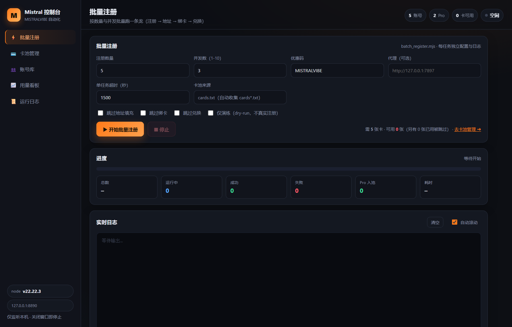
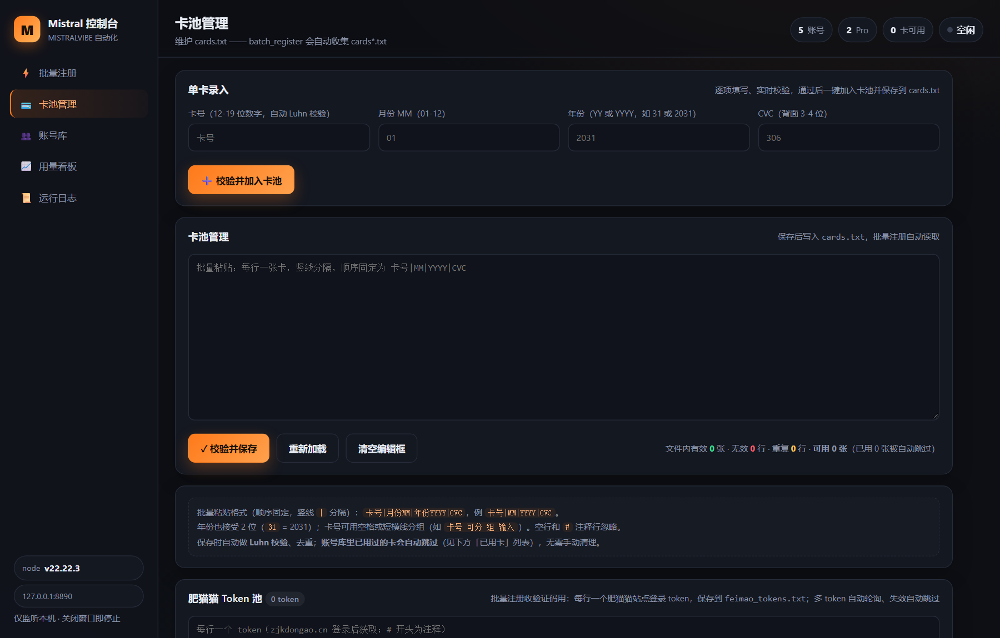
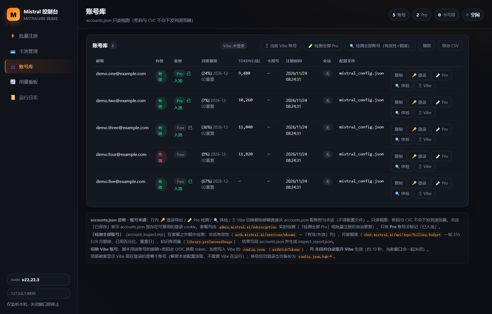
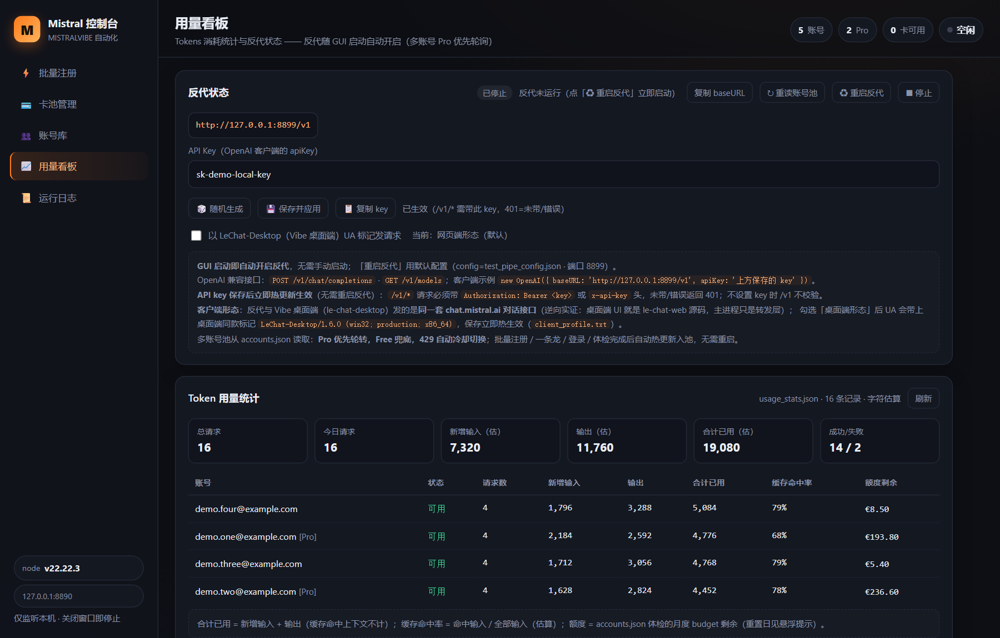
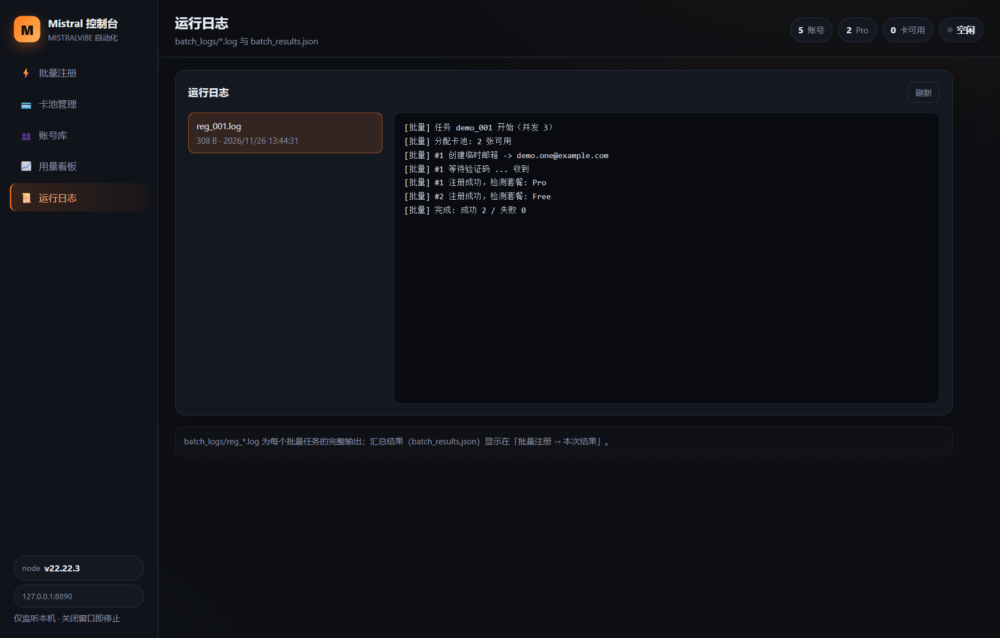

# Mistral 控制台

面向 Mistral Le Chat（chat.mistral.ai）的本地自动化工具集：**批量注册、卡池管理、账号库、用量看板与 OpenAI 兼容反代**，全部功能集中在一个本地 Web GUI 里。

> ⚠️ 仅供学习研究：本项目涉及批量注册、绑卡探测与优惠码兑换，可能违反 Mistral / Stripe 的服务条款；请自行评估风险，后果自负。仓库不含任何真实账号、卡号或会话数据。

## 目录

- [特性](#特性)
- [界面预览](#界面预览)
- [快速开始](#快速开始)
- [首次运行要准备的文件](#首次运行要准备的文件)
- [GUI 功能](#gui-功能)
- [对话反代（OpenAI 兼容）](#对话反代openai-兼容)
- [账号调度：Pro 优先，Free 兜底](#账号调度pro-优先free-兜底)
- [Pro 检测与入池](#pro-检测与入池)
- [账号体检：有效性 + 额度](#账号体检有效性--额度)
- [Token 用量统计](#token-用量统计)
- [临时邮箱与 Token 池](#临时邮箱与-token-池)
- [登录防限流](#登录防限流)
- [上游请求头与路由](#上游请求头与路由)
- [一键切换 Vibe 桌面端账号](#一键切换-vibe-桌面端账号)
- [命令行工具](#命令行工具)
- [端口](#端口)
- [文件说明](#文件说明)
- [常见问题](#常见问题)
- [数据与安全](#数据与安全)

## 特性

| 能力 | 说明 |
|---|---|
| 批量注册 | worker 池并发、卡池自动分配、SSE 实时日志、结果汇总与落盘 |
| 卡池管理 | 单卡录入 / 批量粘贴、Luhn 校验、去重、已用卡自动跳过 |
| 账号库 | `accounts.json` 单一数据源，密码与 CVC 不下发浏览器；支持体检、导出 CSV |
| 对话反代 | OpenAI 兼容 `/v1/chat/completions`，多账号池、429 自动换号、**tools / function calling** |
| 用量看板 | 请求记录 + 账号报表两张表，额度、缓存命中、速度、首字耗时 |
| 账号资产 | Pro 检测、额度体检、会话复用、Vibe 桌面端账号一键切换 |

## 界面预览

> 以下截图使用虚构演示数据（`demo0x@example.com`、占位 API key），不含任何真实账号或卡号。

### 批量注册



### 卡池管理（含邮箱站点 Token 池）



### 账号库



### 用量看板



### 运行日志



## 快速开始

```bash
# 1. 安装依赖（唯一依赖 undici）
npm install

# 2. 启动（默认 http://127.0.0.1:8890，自动拉起反代 8899）
node gui.mjs
```

| 方式 | 命令 |
|---|---|
| 双击启动 | `启动GUI.bat`（端口被占用时可选：杀掉占用进程重启 / 退出 / 打开已在运行的实例） |
| npm | `npm run gui` |
| 自定义端口 | `node gui.mjs --port 9000` |
| 不自动开浏览器 | `node gui.mjs --no-open` |
| 不自动拉起反代 | `node gui.mjs --no-autostart` |

**环境要求**：Node.js ≥ 22.19、Windows（浏览器进程与进程树停止使用 Windows 命令）。

## 首次运行要准备的文件

仓库里没有任何账号或卡号，以下文件都由你自己生成，且全部写在 `.gitignore` 里：

| 文件 | 怎么来 |
|---|---|
| `accounts.json` | 账号库，首次可为 `{}`，注册流程会自动写入 |
| `mistral_config.json` | 注册 / 绑卡配置：`email` / `password` / `card` / `address` / `promo_code`（字段见 `mistral_interactive.mjs` 顶部注释） |
| `cards.txt` | 卡池，GUI「卡池管理」保存生成；每行 `卡号\|MM\|YYYY\|CVC`，`#` 开头为注释 |
| `feimao_tokens.txt` | 临时邮箱站点登录 token 池，每行一个（见 `feimao_tokens.example.txt`）；不建则走游客模式 |
| `proxy_key.txt` | 反代 API Key，GUI 默认启动时自动生成，可在「用量看板」改写；未生成时 `/v1/*` 不校验 |
| `retest_cards.txt` | 冷却卡重测清单，每行 `卡号\|MM\|YYYY\|CVC`，供 `retest_pending.mjs` 读取 |

## GUI 功能

| 页面 | 功能 |
|---|---|
| **批量注册** | 数量 / 并发 / 优惠码 / 代理 / 超时 / 跳过项 / 演练；实时日志、进度、结果汇总；内嵌卡号与配置编辑，以及单账号操作（一条龙、登录导出、重测、Pro 检测、Vibe 切换） |
| **卡池管理** | 单卡录入（实时 Luhn 校验）或批量粘贴 `卡号\|MM\|YYYY\|CVC`，校验去重后保存；**邮箱站 Token 池**（多 token 轮询、失效自动跳过） |
| **账号库** | `accounts.json` 只读视图（密码 / CVC 不下发浏览器）；每行可登录导出、Pro 检测、体检、切换 Vibe；「有效」「月度额度」「Tokens(估)」列；复制邮箱、导出 CSV |
| **用量看板** | 反代状态 / baseURL / 重启 / 停止 / 重读账号池 / API Key 自定义；Token 用量统计；请求记录表与账号报表；反代服务日志 |
| **运行日志** | 查看 `batch_logs/reg_*.log` |

## 对话反代（OpenAI 兼容）

随 GUI 自动开启，默认 `http://127.0.0.1:8899/v1`；优先使用已有配置文件，没有配置文件时仅用 `accounts.json` 的账号池。

| 端点 | 说明 |
|---|---|
| `POST /v1/chat/completions` | 对话补全，支持 `stream`、`stream_options.include_usage`、多轮会话保持、`tools` |
| `GET /v1/models` | 模型清单（mistral-large-4-0 / mistral-medium-latest / zai-glm-5-3 / zai-glm-5-3-flash / deepseek-v4.1-flash） |
| `GET /health` | 健康检查 |
| `GET /admin/pool` · `POST /admin/reload` · `GET /admin/usage` | 池状态 / 热更新 / 用量统计（仅本机回环，免 key） |

```bash
KEY=$(cat proxy_key.txt)
curl -s http://127.0.0.1:8899/v1/chat/completions \
  -H "Authorization: Bearer $KEY" -H 'content-type: application/json' \
  -d '{"model":"mistral-large-4-0","messages":[{"role":"user","content":"你好"}]}'
```

```python
from openai import OpenAI

client = OpenAI(base_url="http://127.0.0.1:8899/v1", api_key=open("proxy_key.txt").read().strip())
print(client.chat.completions.create(
    model="mistral-large-4-0",
    messages=[{"role": "user", "content": "你好"}],
).choices[0].message.content)
```

**API Key**：存放在 `proxy_key.txt`，GUI 首次启动自动生成随机 key；「用量看板」可自定义（8–64 位字母数字 `._-`）或重新生成，**保存即生效**。请求需带 `Authorization: Bearer <key>`（或 `x-api-key`、`?key=`），缺失/错误返回 401；CLI 可用 `--api-key` 覆盖。

**工具调用（tools / function calling）**：客户端在请求里带 `tools` 即可走函数调用循环——上游网页协议不识别原生 tools，反代把工具清单注入首轮消息，模型用 ```tool_calls``` 代码块表示调用，反代解析成标准 `tool_calls` / `finish_reason: "tool_calls"`；客户端回传的 `tool_calls` / `role: "tool"` 结果折叠为 `[tool_result ...]` 文本续聊，按消息指纹增量续发。支持 `tool_choice`、`parallel_tool_calls: false`；带 tools 的流式请求整体缓冲后一次下发。无 tools 的请求保持逐字流式。

## 账号调度：Pro 优先，Free 兜底

- 请求优先在**未冷却的 Pro 账号**间轮转，Pro 全部冷却或没有 Pro 时才轮转 Free 账号；
- 会话粘性：进行中的多轮会话绑定原账号，直到该账号 429 冷却才迁移（迁移同样 Pro 优先）；
- `GET /admin/pool` 返回每账号 `pro` 标记与 `proCount / freeCount / proAvailable / freeAvailable`；
- `--pro-only` 只收已确认 Pro 的账号。

## Pro 检测与入池

只有 **Pro** 账号入池（`accounts.json` 中 `in_pool = true`）。批量注册成功后自动检测、标记入池；已有账号可在「账号库 → 检测全部 Pro」或单账号页检测。

判定：带会话 cookie 请求 `https://admin.mistral.ai/subscription`，解析 `Current plan`（实测 `Pro` / `Free`，兼容 Team / Business / Enterprise）。写回 `pro`、`pro_plan`、`pro_checked_at`、`in_pool`。

## 账号体检：有效性 + 额度

GUI「账号库 → 检测全部账号」或行内「体检」；CLI：`node account_inspect.mjs --all [--concurrency 6] [--proxy ...] | --email <邮箱>`。全部为只读探测：

| 检测项 | 端点 | 结果 |
|---|---|---|
| 会话有效性 | `GET auth.mistral.ai/sessions/whoami` | `valid: true/false`（出口 IP 被 403/429 时标「未知」而非误判失效） |
| 套餐 | `GET admin.mistral.ai/subscription` | `Pro` / `Free` 等 |
| 月度额度 | tRPC `billing.budget`（http2） | `usage_percentage` / `initial_budget` / `currency` / `reset_at` / `payg_enabled` |
| 知识库用量 | tRPC `library.getCurrentUsage` | `isExceeded` / `currentUsage` / `maxUsage` |

写回 `accounts.json`（`valid`、`budget`、`library_usage` 等），汇总产物 `inspect_report.json`（不含密码 / cookie）。

## Token 用量统计

上游事件流不回传 token 用量，反代按字符数估算（≈ 字符 / 4）：

- 每次请求记录一条（账号 / 模型 / 时间 / 输入输出字符与估算 token / 成败），落盘 `usage_stats.json`（保留最近 5000 条，每 5 秒攒批写入）；
- 非流式响应带 `usage` 估算值与 `usage_estimated: true`；流式在 `stream_options.include_usage` 时末尾补一帧 usage；
- `GET /admin/usage` 返回 total / today / byAccount / byModel / recent。

**请求记录表**：新增输入（同一会话相对上次成功请求的增量）、缓存命中（已消费上下文部分）、思考（隐藏 reasoning 分片）、速度（输出 token ÷ 耗时）、首字（首个事件到达耗时）、状态。

**账号报表**：状态（可用 / 冷却剩余秒，含 Pro 标记）、账号累计输入输出、合计已用、缓存命中率、额度剩余（依赖体检结果）。

## 临时邮箱与 Token 池

注册收验证码由 `mistral_mailbox.mjs` 自动创建临时邮箱并提取验证码。游客模式按访客每天约 5 个邮箱限流；登录站点（zjkdongao.cn）后可拿登录 token 走账号态接口，配额按账号计算：

- token 存在 `feimao_tokens.txt`（每行一个，`#` 注释），GUI「卡池管理 → Token 池」可直接粘贴保存；
- 轮询策略：每次创建轮转到下一个健康 token；`401/403` 记失效、429/5xx 冷却 10 分钟；全部不可用时回退游客模式；
- 状态落盘 `feimao_tokens_state.json`，GUI 表格展示；
- 自检：`node mistral_mailbox.mjs --selftest`（校验各 token + 游客额度），加 `--create` 会真实创建一个邮箱（消耗 1 个配额）。

## 登录防限流

- 默认**先复用有效会话**（`ory_session_*` 约 90 天）：先用已有 cookie 探测 `/sessions/whoami`，有效即跳过登录；
- 会话校验也撞 403/429 说明出口 IP 被限流，直接退出并提示换代理；
- 需要强刷时勾选「强制全新登录」（`--fresh`），或通过 `--proxy http://127.0.0.1:7897` 换出口 IP。

## 上游请求头与路由

`mistral_chat_api.mjs` 按逆向结论与实测逐头对齐官方 web 客户端：

- tRPC 端点带 `x-trpc-source: nextjs-react`、`x-le-chat-inactive-message-content: on-demand`；**刻意不发 `trpc-accept`**（带它会切成 superjson JSONL 分片流，不带返回整段 JSON 数组，解析层双格式兼容）；
- `/api/chat` 只显式设 `content-type`，`accept: */*`；同源 GET 不发 `origin`，POST 带 `content-length`；`accept-encoding` 刻意不发（http2 事件流需明文）；
- **代理出口走 CONNECT 隧道 + http2**（`--proxy` 或环境变量 `MISTRAL_PROXY`），避免 fetch/h1 指纹被 Cloudflare 挑战；
- **客户端形态**（web / desktop）：Vibe 桌面端与网页端是同一套对话 API，差异仅在 UA 追加 `LeChat-Desktop/1.6.0 (win32; production; x86_64)`；GUI 勾选「桌面端形态」即带该标记（存 `client_profile.txt`，热生效；CLI 等价 `--client-profile desktop`）；
- **自动换路**：直连 → 借道备用 IP（解析 `auth/api.mistral.ai`，用其 IP + SNI 走 CF 共享边缘）→ 代理隧道，连接层失败自动换路（每条路 2 次，已出字节不重试），成功后粘住可用路由；
- 上游 403 挑战时明确提示「IP 风控，稍后重试或换出口 IP」（`cf_challenged: true`）。

## 一键切换 Vibe 桌面端账号

GUI 账号库每行的「🖥 Vibe」，或单账号页「切换到该账号」；顶部可查当前 Vibe 登录的是谁。

原理：Vibe 不读浏览器 cookie，登录态是 OIDC token，加密存在 `%APPDATA%\le-chat-desktop\config.json` 的 `authOidcTokens`（Electron safeStorage：`v10` + AES-256-GCM，密钥由 DPAPI 保护在 `Local State`）。`vibe_login.mjs` 用邮箱 + 密码走 OIDC authorization code + PKCE 换 token，再用 DPAPI 解出本机 OSCrypt 密钥、按 Vibe 格式重新加密并原子写入（旧文件备份为 `config.json.bak-*`），最后由 detached 子进程等 Vibe 退出 → 写配置 → 重启 → 校验写回的 `id_token` 邮箱。

> ⚠️ Vibe 只在启动时读取 `authOidcTokens`，因此切换后会自动重启一次。若 GUI 是从 Vibe 内置终端启动的，建议改用 `启动GUI.bat`，避免 GUI 被一并关掉。

## 命令行工具

| 命令 | 作用 |
|---|---|
| `node batch_register.mjs --count 10 --concurrency 3` | 批量注册（`--cards` 指定卡池文件） |
| `node pipeline.mjs --config mistral_config.json` | 单账号一条龙：注册 → 地址 → 绑卡 → 兑换 → 登录导出 |
| `node mistral_login.mjs --config <cfg>` | 纯协议登录并导出 cookie（`--proxy`、`--fresh`） |
| `node pro_check.mjs --config <cfg>` | Pro 检测 |
| `node account_inspect.mjs --all` | 全量体检（有效性 + 额度） |
| `node retest_pending.mjs --config <cfg> [--cards 文件]` | 冷却卡轮询重测 |
| `node reverse_proxy.mjs [--port 8899] [--api-key k] [--pro-only]` | 单独启动反代 |
| `node vibe_login.mjs --config <cfg> [--apply]` | 取 token / 切换到 Vibe 桌面端 |
| `node mistral_mailbox.mjs --selftest [--create]` | 邮箱服务与 token 池自检 |

## 端口

| 端口 | 用途 |
|---|---|
| `8890` | GUI 默认端口 |
| `8899` | `reverse_proxy.mjs` 默认端口 |

冲突时用 `node gui.mjs --port <端口>`；批量注册与反代不要共用同一端口。

## 文件说明

| 文件 | 作用 |
|---|---|
| `gui.mjs` | GUI 服务端（`node:http`，仅监听 127.0.0.1） |
| `gui.html` | 前端单页（深色控制台，无外部资源） |
| `启动GUI.bat` | 双击启动器 |
| `batch_register.mjs` | 批量注册调度（worker 池、卡池分配、日志、`batch_results.json`） |
| `pipeline.mjs` | 单账号一条龙 |
| `mistral_interactive.mjs` | 注册 / 绑卡 / 兑换主流程 |
| `mistral_login.mjs` | 纯协议登录 + cookie 导出 |
| `reverse_proxy.mjs` | OpenAI 兼容反代（账号池、热更新、Pro 优先轮换、用量统计） |
| `mistral_chat_api.mjs` | chat.mistral.ai http2 客户端（请求头对齐、隧道代理、tRPC 解析） |
| `pro_check.mjs` | Pro 检测（写回 `accounts.json`） |
| `account_inspect.mjs` | 账号体检（有效性、套餐、额度、知识库用量） |
| `retest_pending.mjs` | 冷却卡重测（读本地 `retest_cards.txt`） |
| `vibe_login.mjs` | 切换 Vibe 桌面端账号 |
| `mistral_accounts.mjs` / `mistral_mailbox.mjs` / `mistral_address_parser.mjs` | 支撑库 |
| `accounts.json` / `cookies/` / `cards.txt` / `retest_cards.txt` / `batch_logs/` | 见上方「首次运行要准备的文件」，均不入库 |

## 常见问题

**启动后浏览器打不开 / 端口被占？** 用 `node gui.mjs --port <端口>` 换端口；`启动GUI.bat` 会给出「杀掉占用进程 / 退出 / 打开已运行实例」三个选项。

**启动时报 `test_pipe_config.json` / `accounts.json` 找不到（ENOENT）？** 仓库按设计不附带这两个文件（配置文件含会话 cookie、`accounts.json` 含账号，均已列入 `.gitignore`）。反代会给出提示并只使用已有账号；首次使用请先在 GUI 完成一次注册（自动生成 `accounts.json`），或在「批量注册 → 配置编辑」新建配置，也可以用 `--config` 指定自己的配置文件。
**反代返回 401？** `/v1/*` 需要 `proxy_key.txt` 里的 key（`Authorization: Bearer`、`x-api-key` 或 `?key=`）。GUI 未生成过 key 时该文件不存在，此时不校验。

**反代返回 403 且提示 cf_challenged？** 出口 IP 被 Cloudflare 风控，换出口 IP 或稍后重试。

**注册一直卡在验证码？** 检查 `feimao_tokens.txt` 是否有效（`node mistral_mailbox.mjs --selftest`），或临时邮箱配额是否用完。

**账号显示「冷却」？** 该账号收到 429，反代按剩余秒数冷却后自动恢复，无需手动干预。

## 数据与安全

- `accounts.json`、`cookies/`、`cards.txt`、`retest_cards.txt`、`proxy_key.txt` 含**明文敏感数据**（密码、卡号、会话 cookie、访问 key），请勿提交到任何仓库；
- 本仓库不含任何账号、卡号、会话 cookie 或 token，上述文件均已列入 `.gitignore`；
- GUI 只监听 `127.0.0.1`，账号库接口不下发密码与 CVC；
- 本项目涉及批量注册、绑卡探测与优惠码兑换，可能违反 Mistral / Stripe 的服务条款，使用后果自负；仓库未附带开源许可证，默认保留所有权利。
